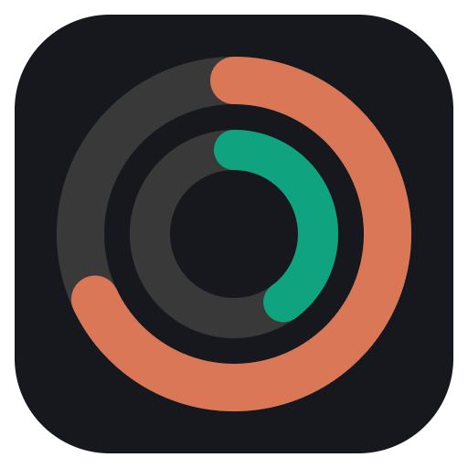
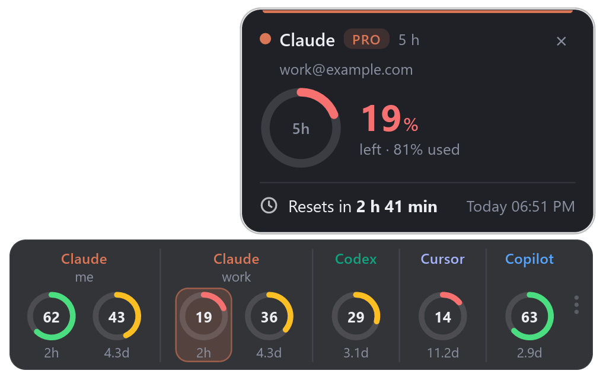
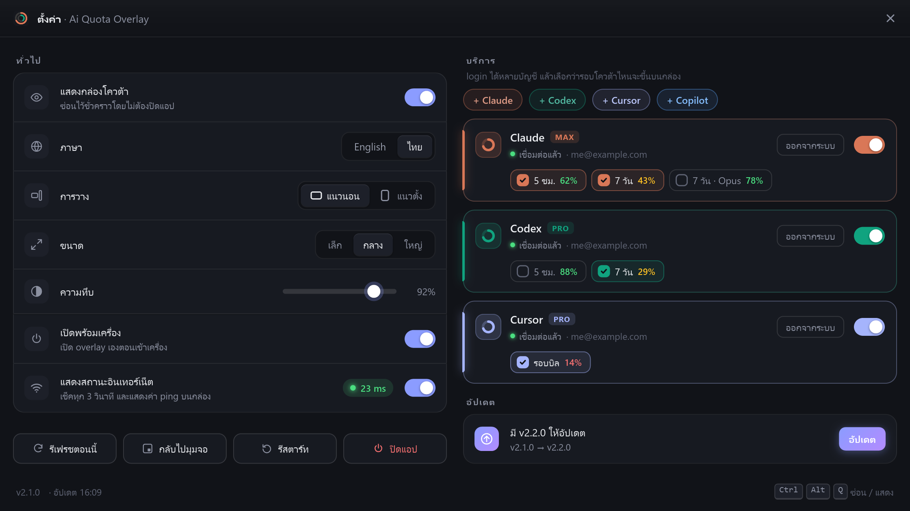
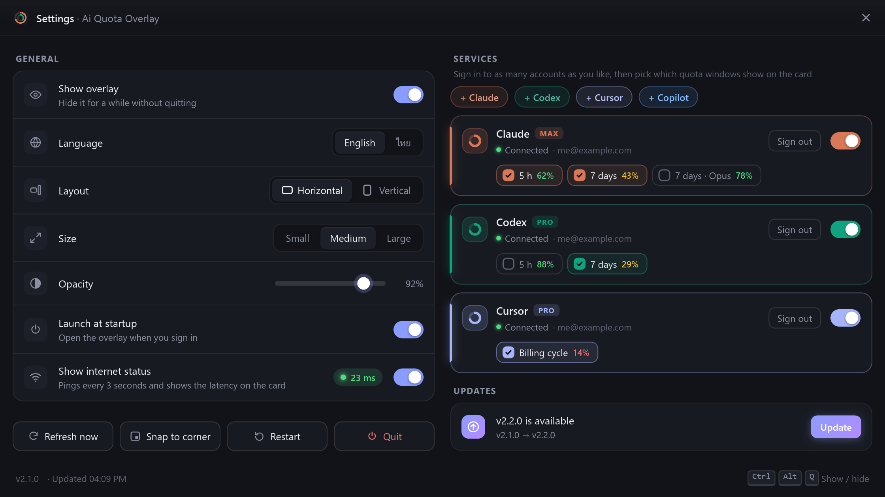
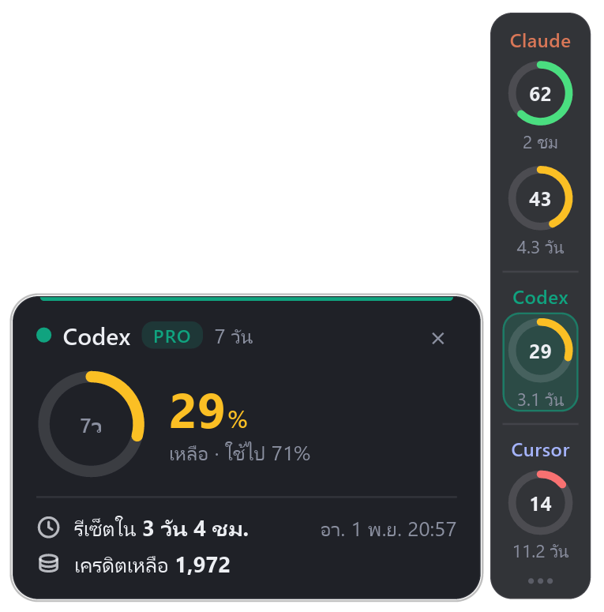
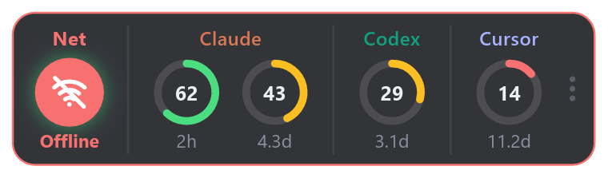
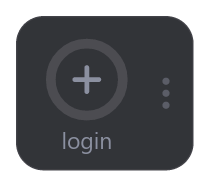
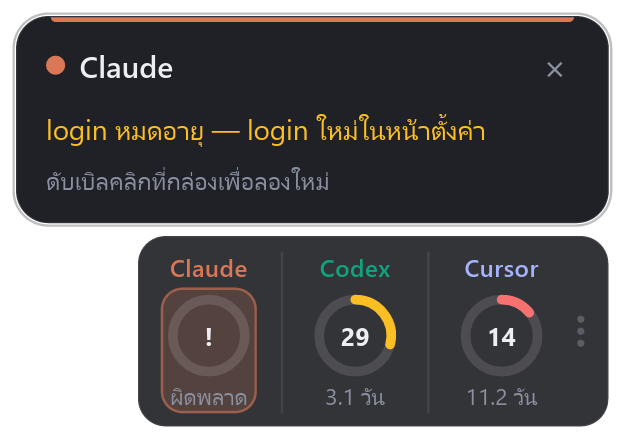
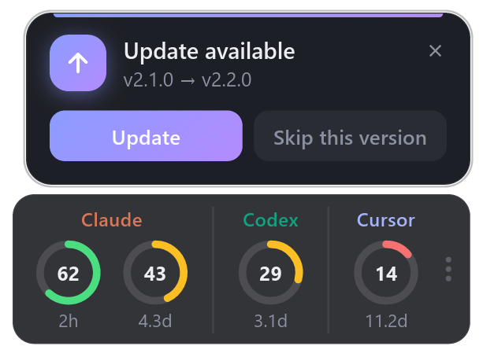

<div align="center">



# Ai Quota Overlay

**วงล้อเล็กๆ ลอยบนจอ บอกว่าโควต้า Claude · Codex · Cursor · Copilot เหลือเท่าไหร่ และจะรีเซ็ตเมื่อไหร่**

*Tiny always-on-top rings showing how much of your Claude, Codex, Cursor and Copilot quota is left.*

[](https://github.com/artmasster/ai_quota_overlay/releases/latest)
[](https://github.com/artmasster/ai_quota_overlay/releases)


[](LICENSE)



**[📥 ดาวน์โหลด](#-ดาวน์โหลด)** · [🔑 เริ่มใช้](#-เริ่มใช้) · [🖱️ วิธีใช้](#️-วิธีใช้) · [❓ แก้ปัญหา](#-แก้ปัญหา) · [📝 มีอะไรใหม่](#-มีอะไรใหม่)

</div>

---

## ✨ ทำอะไรได้

- 🟢 **วงละรอบโควต้า** บอก % ที่เหลือ (เขียว > 50% · เหลือง > 20% · แดง) และเวลาก่อนรีเซ็ต `35m` `2h` `4.3d`
- 🔑 **login ในแอปได้เลย** ผ่านหน้าเว็บของแต่ละเจ้า ไม่ต้องลง CLI · **หลายบัญชีต่อบริการ** เช่น Claude 2 บัญชี
- 👆 **คลิกที่วง** ดูรายละเอียด: ใช้ไปเท่าไหร่ รีเซ็ตกี่โมง เครดิตที่เหลือ
- ☑️ **เลือกได้** ว่าบัญชีไหน รอบไหน (5 ชม. / 7 วัน / Opus / รอบบิล …) ขึ้นบนกล่อง · ลากเรียงลำดับบัญชีได้
- 🖱️ **วางตรงไหนก็ได้** ทุกจอ · แนวนอน / แนวตั้ง · 3 ขนาด · ปรับความทึบ · ลอยบนสุดแต่ไม่แย่ง focus
- ⚡ **อัปเดตไวแต่ไม่รัว** เช็คทุก 1 นาที (Claude / Copilot ทุก 5 นาที) โดน 429 ก็ยังโชว์ตัวเลขล่าสุด
- 📶 สถานะอินเทอร์เน็ต *(ไม่บังคับ)* · ⬆️ อัปเดตในแอป · 🌐 English / ไทย
- 🪶 **เบามาก** เขียนด้วย Rust: ตัวติดตั้ง ~1.5 MB · 1 process · RAM ~25 MB (เวอร์ชัน Electron เดิม 94 MB / ~400 MB)

## 📥 ดาวน์โหลด

ที่ **[Releases ล่าสุด](https://github.com/artmasster/ai_quota_overlay/releases/latest)**

| ระบบ | ไฟล์ | อัปเดตในแอป |
|---|---|---|
| 🪟 **Windows 10 / 11** | `AiQuotaOverlay-x.y.z-win-x64-setup.exe` (sign แล้ว ไม่ต้องใช้ admin) | ✅ อัตโนมัติ |
| 🍎 **macOS** Apple Silicon / Intel | `…-mac-arm64.dmg` / `…-mac-x64.dmg` | ↗️ เปิดหน้าดาวน์โหลด |
| 🐧 **Linux** | `…-linux-x86_64.AppImage` / `…-linux-amd64.deb` | ✅ AppImage · ✋ `.deb` ลงทับเอง |

<details>
<summary><b>macOS / Linux เปิดครั้งแรกแล้วโดนเตือน?</b></summary>

- **macOS** (ยังไม่ได้ sign): ลากแอปไปไว้ใน Applications แล้วรัน `xattr -cr "/Applications/Ai Quota Overlay.app"` ครั้งเดียว หรือคลิกขวา → **Open**
- **Linux AppImage**: `chmod +x AiQuotaOverlay-*.AppImage` ก่อน (หน้าต่างโปร่งใสต้องมี compositor · Wayland ใช้ผ่าน XWayland)
</details>

## 🔑 เริ่มใช้

คลิกขวาที่กล่อง (หรือ `⋯`) เพื่อเปิดหน้าแอป → หมวด **บริการ** → กด **+ Claude** / **+ Codex** / **+ Cursor** / **+ Copilot** แล้ว login ในเบราว์เซอร์ เสร็จแล้วขึ้นบนกล่องเลย กดซ้ำเพื่อเพิ่มบัญชีถัดไป

| บริการ | login ด้วย | นับอะไร |
|---|---|---|
|  | บัญชี claude.ai (Pro / Max / Team) | รอบ 5 ชม. · 7 วัน · Opus · Sonnet |
|  | บัญชี ChatGPT | รอบ 5 ชม. · 7 วัน · เครดิต |
|  | บัญชี Cursor | รอบบิล |
|  | บัญชี GitHub (แอปคัดลอกโค้ดให้ วางในหน้า GitHub) | premium requests รายเดือน |

<p align="center"></p>

<details>
<summary><b>หน้าแอปภาษาอังกฤษ</b></summary>
<p align="center"></p>
</details>

> [!NOTE]
> token เก็บไว้ในเครื่องนี้เท่านั้น (`accounts.json`) และส่งไปแค่เซิร์ฟเวอร์ของเจ้าของบริการเอง ไม่มีเซิร์ฟเวอร์กลาง
> การ login ใช้ช่องทางเดียวกับแอปของแต่ละเจ้า (Claude Code, Codex CLI, Cursor, Copilot) และตัวเลขมาจาก API ภายในที่ไม่ได้เปิดเป็นทางการ ถ้าเจ้าของเปลี่ยนอะไร วงจะขึ้น `!` จนกว่าจะอัปเดตแอป

## 🖱️ วิธีใช้

| ทำอะไร | ผล |
|---|---|
| **คลิกที่วง** | ดูรายละเอียด (คลิกด้านนอกเพื่อปิด) |
| **คลิกขวา** ที่กล่อง · `⋯` · ไอคอน tray | เปิดหน้าแอป |
| **ลาก** กล่อง | ย้ายตำแหน่ง (จำไว้ให้) |
| **ดับเบิลคลิก** พื้นที่ว่าง | เช็คทุกบัญชีเดี๋ยวนี้ |
| **ลากการ์ดบัญชี** ในหน้าแอป | เรียงลำดับบนกล่องใหม่ |
| <kbd>Ctrl</kbd> + <kbd>Alt</kbd> + <kbd>Q</kbd> | ซ่อน / แสดงกล่อง |

<table>
<tr>
<td align="center"><b>แนวตั้ง</b><br></td>
<td align="center"><b>หลุดเน็ต</b><br><br><br><b>ยังไม่มีบัญชี</b><br></td>
</tr>
<tr>
<td align="center"><b>login หมดอายุ</b><br></td>
<td align="center"><b>มีอัปเดต</b><br></td>
</tr>
</table>

## ❓ แก้ปัญหา

| อาการ | ทำไง |
|---|---|
| วงขึ้น `!` | คลิกที่วงอ่านสาเหตุ · login หมดอายุให้กด **login** ที่บัญชีนั้นในหน้าแอป |
| ขึ้น "รอเช็คใหม่" | เซิร์ฟเวอร์ขอให้รอ (429) ตัวเลขล่าสุดยังอยู่ เดี๋ยวแอปลองใหม่เอง |
| เพิ่มบัญชีที่ 2 แล้วได้บัญชีเดิม | ออกจากระบบในเว็บนั้นก่อน หรือกด **คัดลอกลิงก์** ไปเปิดในหน้าต่างส่วนตัว |
| login Codex: พอร์ต 1455 ถูกใช้อยู่ | ปิด `codex login` ที่ค้างอยู่ก่อน |
| หากล่องไม่เจอ | <kbd>Ctrl</kbd> + <kbd>Alt</kbd> + <kbd>Q</kbd> หรือหน้าแอป → **กลับไปมุมจอ** |
| ไม่ขึ้นทับเกม | ใช้โหมด Borderless / Windowed (Exclusive fullscreen ไม่มี overlay ไหนขึ้นได้) |

ถอนการติดตั้ง: Windows → **Settings → Apps** · macOS ลบแอป · Linux ลบ AppImage หรือ `sudo apt remove ai-quota-overlay`
ข้อมูลอยู่ที่ `%APPDATA%\Ai Quota Overlay` · `~/Library/Application Support/Ai Quota Overlay` · `~/.config/Ai Quota Overlay`

## 📝 มีอะไรใหม่

**2.1.0**
- **login ในแอปได้เลย** ไม่ต้องลง CLI · **หลายบัญชีต่อบริการ** ชื่อบัญชีกำกับใต้ชื่อบริการ · ลากเรียงลำดับได้
- เพิ่ม **GitHub Copilot**
- ไม่อ่าน login ของ Claude Code / Codex CLI / แอป Cursor ในเครื่องแล้ว: **อัปเดตแล้ว login ในแอปใหม่ครั้งเดียว**
- Claude / Copilot เช็คทุก 5 นาที ไม่โดน 429 ถี่ๆ · โดนแล้วขึ้น "รอเช็คใหม่" แทน "ผิดพลาด"
- แก้กรอบขาวที่แวบขึ้นบนกล่องทุกนาที · สวิตช์ไม่เด้งกลับตอนปิด · แท็บเลือกเลื่อนนุ่ม

**2.0.x** เขียนใหม่ด้วย Rust (เล็กลงจาก 94 MB เหลือ 1.5 MB) · 3 ขนาดกล่อง · เก็บตัวเลขล่าสุดไว้ตอนเช็คไม่ผ่าน · หน้าแอป 16:9 ลื่นขึ้น
ทุกเวอร์ชัน: [Releases](https://github.com/artmasster/ai_quota_overlay/releases)

<details>
<summary><b>🛠️ พัฒนา</b></summary>

ต้องมีแค่ [Rust](https://rustup.rs) (Windows: MSVC หรือ `stable-x86_64-pc-windows-gnu` + [WinLibs](https://winlibs.com) · macOS: Xcode CLT · Linux: `build-essential`)

```bash
git clone https://github.com/artmasster/ai_quota_overlay.git && cd ai_quota_overlay
cargo run
```

| คำสั่ง / ตัวแปร | ทำอะไร |
|---|---|
| `cargo test` | เทสต์ (ไม่ใช้เน็ต ไม่ใช้ login จริง) |
| `cargo run -- --screenshots docs` | ถ่ายภาพใน README ใหม่จากข้อมูลจำลอง (`AQO_SHOT_EXTRA=1` ได้ทุกสถานะ + จับเวลาแอนิเมชัน) |
| `QUOTA_OVERLAY_DATA_DIR=<โฟลเดอร์>` | เก็บ settings / บัญชีที่อื่น ไม่ทับของจริง |
| `QUOTA_OVERLAY_LOG_REQUESTS=<ไฟล์>` · `QUOTA_OVERLAY_LOG_FRAMES=<ไฟล์>` | บันทึก URL ที่เรียก (ไม่มี token) · เวลาวาดแต่ละเฟรม |
| `QUOTA_OVERLAY_FAKE_429=claude:90` · `QUOTA_OVERLAY_FAKE_UPDATE=9.9.0` | จำลอง 429 · จำลองว่ามีอัปเดต |

โค้ด: [`src/app.rs`](src/app.rs) จังหวะเช็ค ตำแหน่ง แอนิเมชัน · [`src/quota/`](src/quota) ดึงโควต้า + login (`login.rs`) + บัญชี (`store.rs`) · [`src/ui/`](src/ui) วาดเองด้วย tiny-skia + cosmic-text · [`src/platform/`](src/platform) Win32 / winit

**ออก release:** แก้ `version` ใน `Cargo.toml` → push tag `v<version>` (Actions สร้าง draft ที่มี macOS / Linux) → `pwsh scripts/release-windows.ps1 -Publish` (sign ตัว Windows บนเครื่อง Siam แล้ว publish)
</details>

## 📄 License

[MIT](LICENSE) © artmasster
