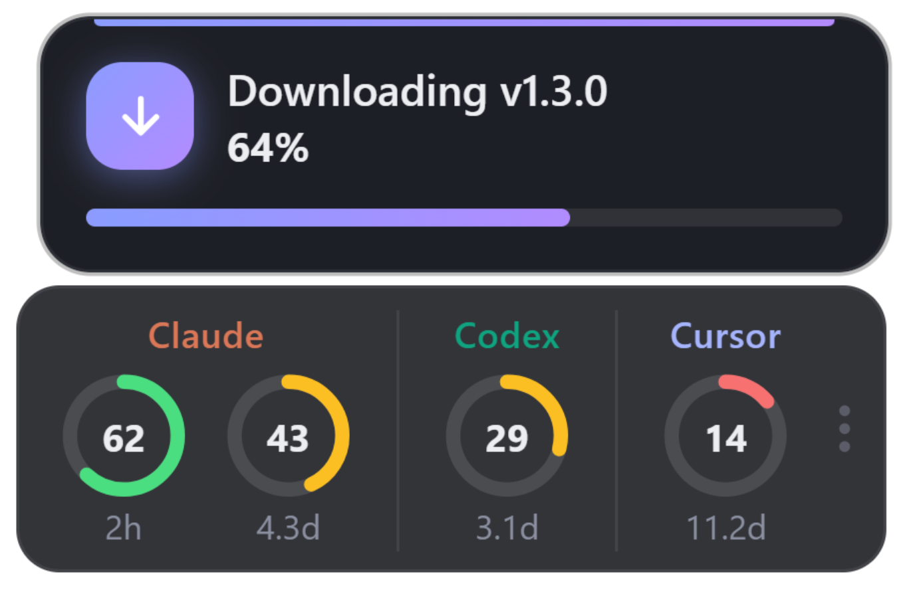
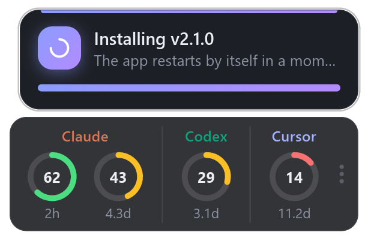
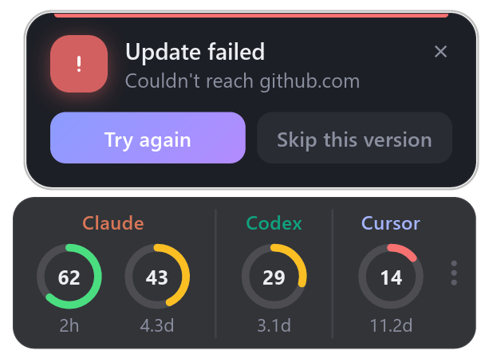
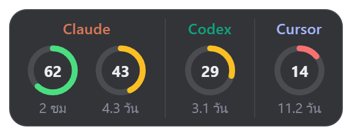
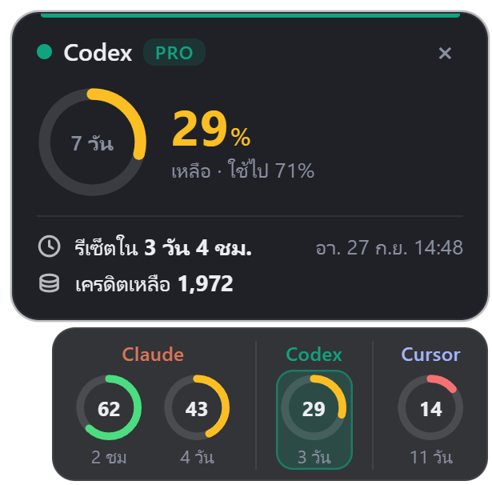
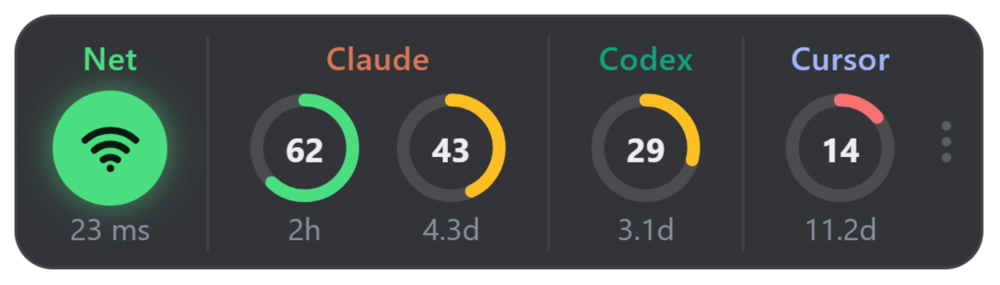
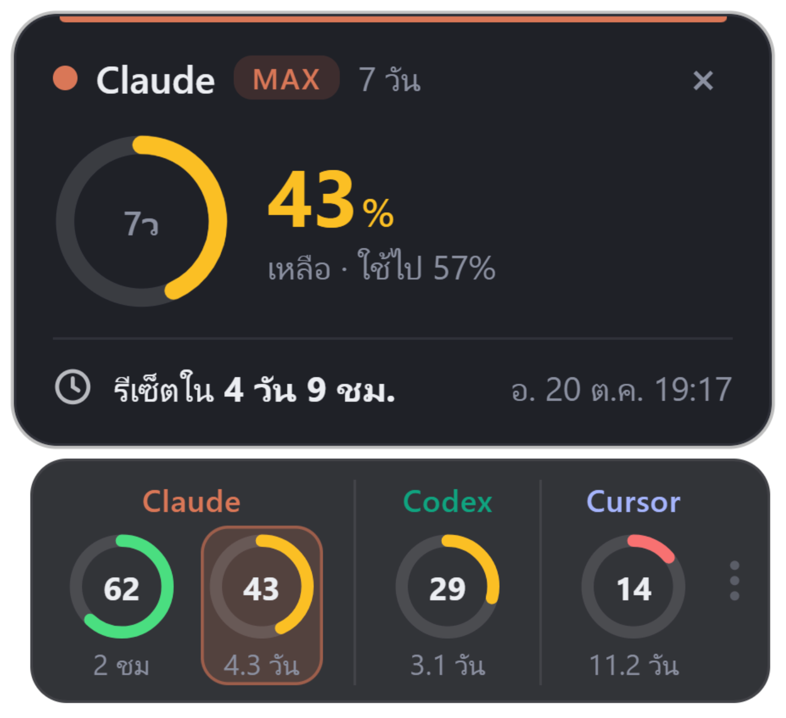

<div align="center">


# Ai Quota Overlay

**วงล้อเล็กๆ ลอยบนจอ บอกว่าโควต้า Claude · Codex · Cursor เหลือเท่าไหร่ และจะรีเซ็ตเมื่อไหร่**

*Tiny always-on-top rings showing how much of your Claude, Codex and Cursor quota is left.*

[](https://github.com/artmasster/ai_quota_overlay/releases/latest)
[](https://github.com/artmasster/ai_quota_overlay/releases)


[](LICENSE)


**[📥 ดาวน์โหลด](#-ดาวน์โหลด)** · [🔑 ต้อง login อะไร](#-ต้อง-login-อะไรไว้บ้าง) · [🖱️ วิธีใช้](#️-วิธีใช้) · [⚙️ หน้าแอป](#️-หน้าแอป) · [❓ แก้ปัญหา](#-แก้ปัญหา) · [🛠️ พัฒนา](#️-พัฒนา) · [📝 มีอะไรใหม่](#-มีอะไรใหม่)

</div>

---

## ✨ ทำอะไรได้

|   |   |
|---|---|
| 🟢 **วงล้อบอก % ที่เหลือ** | เขียว > 50% · เหลือง > 20% · แดง ≤ 20% |
| ⏳ **เวลาก่อนรีเซ็ต** | ตัวเลขใต้วง `35m` · `2h` · `4.3d` นับลงเอง |
| 👆 **คลิกที่วงดูรายละเอียด** | เหลือ / ใช้ไป, รีเซ็ตวันไหนกี่โมง, เครดิตที่เหลือ |
| ☑️ **เลือกได้ว่าจะโชว์อะไร** | เปิด/ปิดทีละบริการ และเลือกรอบโควต้า (5 ชม. / 7 วัน / Opus / รอบบิล …) ที่จะขึ้นบนกล่อง |
| 🙈 **โชว์เฉพาะที่ login ไว้** | ไม่ได้ใช้ Cursor ก็ไม่ขึ้น |
| 🖱️ **วางตรงไหนก็ได้** | ลากไปได้ทุกจอ (scale ต่างกันก็ได้) · แนวนอน / แนวตั้ง · ปรับความทึบ |
| 🎮 **ไม่บังงาน** | ลอยบนสุด ไม่แย่ง focus กินที่แค่ตัวกล่อง |
| ⚡ **อัปเดตไว แต่ไม่รัว** | เช็คโควต้าทุก 1 นาที (ซ่อนกล่องอยู่ทุก 5 นาที) ไม่ยิงซ้อน โดน 429 จะพักเจ้านั้น 2 → 15 นาที และโชว์ตัวเลขล่าสุดไว้ก่อน |
| 📶 **สถานะอินเทอร์เน็ต** *(ไม่บังคับ)* | ไฟเขียว + ping ทุก 3 วินาที หลุดเน็ตไฟแดงกะพริบ (ปิดไว้เป็นค่าเริ่มต้น) |
| ⬆️ **อัปเดตในแอป** | มีเวอร์ชันใหม่ขึ้นเตือนเล็กๆ กดครั้งเดียว ดาวน์โหลด ติดตั้ง เปิดใหม่ให้เอง |
| 🌐 **2 ภาษา** | English / ไทย สลับได้ทันที |
| 🔒 **ไม่ต้องใส่รหัสอะไร** | ใช้ login ที่แอปของแต่ละเจ้ามีอยู่แล้วในเครื่อง ไม่มีเซิร์ฟเวอร์กลาง |

### 🪶 เบามาก

เขียนด้วย **Rust** วาดหน้าจอเองทั้งหมด ไม่มี browser / webview อยู่ข้างใน (เวอร์ชัน 1.x เป็น Electron)

| | **2.x (Rust)** | 1.x (Electron) |
|---|---:|---:|
| ตัวติดตั้ง Windows | **1.5 MB** | 94 MB |
| ขนาดหลังติดตั้ง | **3.2 MB** | 324 MB |
| จำนวน process | **1** | 5 |
| RAM (working set) | **~24 MB** | ~400 MB |

<sub>วัดบน Windows 11 ตอนกล่องแสดงอยู่และหน้าแอปปิด · CPU ตอนว่างของตัว Rust แทบ 0%</sub>

## 📥 ดาวน์โหลด

ไปที่ **[Releases ล่าสุด](https://github.com/artmasster/ai_quota_overlay/releases/latest)** แล้วเลือกไฟล์ตามเครื่อง

| ระบบ | ไฟล์ | อัปเดตในแอป |
|---|---|---|
| 🪟 **Windows 10 / 11** | `AiQuotaOverlay-x.y.z-win-x64-setup.exe` | ✅ อัตโนมัติ |
| 🍎 **macOS** Apple Silicon (M1 ขึ้นไป) | `AiQuotaOverlay-x.y.z-mac-arm64.dmg` | ↗️ เปิดหน้าดาวน์โหลด |
| 🍎 **macOS** Intel | `AiQuotaOverlay-x.y.z-mac-x64.dmg` | ↗️ เปิดหน้าดาวน์โหลด |
| 🐧 **Linux** (ทุก distro) | `AiQuotaOverlay-x.y.z-linux-x86_64.AppImage` | ✅ อัตโนมัติ |
| 🐧 **Ubuntu / Debian** | `AiQuotaOverlay-x.y.z-linux-amd64.deb` | ✋ ติดตั้ง `.deb` ใหม่เอง |

> [!TIP]
> **ตัว Windows sign ด้วยใบรับรอง code signing** ติดตั้งแบบรายผู้ใช้ ไม่ต้องใช้สิทธิ์ admin
> ใครยังใช้ **1.x (Electron)** อยู่ แอปจะเตือนอัปเดตให้เอง กด **Update** ได้เลย ตัวใหม่จะลงแทนในโฟลเดอร์เดิม ตำแหน่งกล่องและ settings เดิมอยู่ครบ

<details>
<summary><b>macOS / Linux เปิดครั้งแรกแล้วโดนเตือน?</b></summary>

- **macOS** (ยังไม่ได้ sign) — ลากแอปไปไว้ใน Applications แล้วรันใน Terminal ครั้งเดียว:
  ```bash
  xattr -cr "/Applications/Ai Quota Overlay.app"
  ```
  หรือคลิกขวาที่แอป → **Open** → **Open**
- **Linux AppImage** — ให้สิทธิ์รันก่อน:
  ```bash
  chmod +x AiQuotaOverlay-*.AppImage && ./AiQuotaOverlay-*.AppImage
  ```
</details>

## 🔑 ต้อง login อะไรไว้บ้าง

แอปอ่าน login ที่โปรแกรมของแต่ละเจ้าเก็บไว้ในเครื่องอยู่แล้ว **login ไว้ตัวไหน ก็ขึ้นตัวนั้น**

| บริการ | ต้องมี | login เก็บที่ |
|---|---|---|
|  | [Claude Code](https://claude.com/claude-code) CLI — พิมพ์ `claude` แล้ว `/login` | Windows / Linux: `~/.claude/.credentials.json` · macOS: Keychain |
|  | [Codex](https://openai.com/codex) (แอปหรือ CLI) login ด้วยบัญชี ChatGPT | `~/.codex/auth.json` |
|  | แอป [Cursor](https://cursor.com) ที่ login แล้ว | `state.vscdb` ในโฟลเดอร์ config ของ Cursor (อ่านอย่างเดียว) |

> [!NOTE]
> token ถูกส่งไปแค่เซิร์ฟเวอร์ของเจ้าของบริการเอง (`api.anthropic.com` · `chatgpt.com` · `cursor.com`) ไม่มีเซิร์ฟเวอร์กลาง ไม่มีการเก็บข้อมูล
> ตัวเลขโควต้ามาจาก API ภายในที่ไม่ได้เปิดเป็นทางการ ถ้าวันหนึ่งเจ้าของเปลี่ยนรูปแบบ วงจะขึ้น `!` แทนตัวเลขจนกว่าจะอัปเดตแอป

## 🖱️ วิธีใช้

| ทำอะไร | ผล |
|---|---|
| **คลิกที่วง** | เปิดกล่องรายละเอียด (คลิกด้านนอก / คลิกวงเดิม / `×` เพื่อปิด) |
| **คลิก `⋯`** ท้ายกล่อง หรือ **คลิกขวา** ที่กล่อง | เปิดหน้าแอป |
| **คลิก** ไอคอน tray (ข้างนาฬิกา) | เปิดหน้าแอป (Linux: เมนูเล็กๆ เปิดหน้าแอป / ปิดแอป) |
| **เปิดแอปซ้ำ** จาก Start menu / Launchpad | เปิดหน้าแอป (ไม่เปิดซ้อนอีกตัว) |
| **ลาก** ตรงไหนของกล่องก็ได้ | ย้ายตำแหน่ง จำไว้ให้ครั้งหน้า |
| **ดับเบิลคลิก** พื้นที่ว่างในกล่อง | รีเฟรชทันที |
| <kbd>Ctrl</kbd> + <kbd>Alt</kbd> + <kbd>Q</kbd> | ซ่อน / แสดงกล่อง |

กล่องรายละเอียดจะเปิดไปทาง **กลางจอ** เสมอ: วางไว้มุมขวาล่าง กล่องจะเปิดขึ้นบน, วางแนวตั้งชิดขวา กล่องจะเปิดไปทางซ้าย

## ⚙️ หน้าแอป

ตั้งค่าทุกอย่างได้ในหน้าเดียว มีผลทันที ไม่ต้องรีสตาร์ท หน้าต่างเป็น **16:9 ขนาดคงที่ เห็นครบโดยไม่ต้องเลื่อน**
(ถ้าจอเล็กกว่าหน้าต่าง หน้าต่างจะย่อตามสัดส่วนเดิม และเลื่อนดูส่วนที่เหลือได้)

<p align="center"></p>

<details>
<summary><b>ภาษาอังกฤษ</b></summary>
<p align="center"></p>
</details>

| ส่วน | ตั้งอะไรได้ |
|---|---|
| **ทั่วไป** | แสดง / ซ่อนกล่อง · ภาษา English / ไทย · แนวนอน / แนวตั้ง · ความทึบ 50 – 100% · เปิดพร้อมเครื่อง (Windows / macOS) |
| **สถานะอินเทอร์เน็ต** | ไฟสถานะเน็ต + ping ทุก 3 วินาที (ค่าเริ่มต้น **ปิด** ปิดอยู่หรือซ่อนกล่องไว้จะไม่ ping เลย) |
| **บริการ** | เปิด / ปิด Claude · Codex · Cursor ทีละเจ้า (ปิดแล้วไม่เช็คโควต้าเจ้านั้นเลย) และติ๊กเลือกรอบโควต้าที่จะขึ้นบนกล่อง พร้อม % ที่เหลือ |
| **อัปเดต** | เวอร์ชันปัจจุบัน · เช็คอัปเดตตอนนี้ · อัปเดต (แม้จะเคยกดข้ามไว้) |
| **ปุ่ม** | รีเฟรชตอนนี้ · กลับไปมุมจอ (มุมขวาล่าง) · รีสตาร์ท · ปิดแอป |

## ⬆️ อัปเดตแอป

แอปเช็ค [Releases](https://github.com/artmasster/ai_quota_overlay/releases) เอง: หลังเปิดแอป 5 วินาที, ทุก 15 นาที, ตอนเปิดหน้าแอป และตอนเครื่องตื่นจาก sleep ถ้ามีเวอร์ชันใหม่จะขึ้นกล่องเล็กๆ ข้างกล่องโควต้า

- **Update** → ดาวน์โหลด (มีแถบ %) → ตรวจ checksum → ติดตั้งเงียบๆ → เปิดแอปใหม่ให้เอง
- **Skip this version** → ไม่เตือนเวอร์ชันนี้อีก จนกว่าจะมีเวอร์ชันที่ใหม่กว่า (ยังกดอัปเดตจากหน้าแอปได้)
- **×** → ปิดไว้ก่อน เตือนใหม่ตอนเปิดแอปครั้งหน้า

ไม่มีอะไรดาวน์โหลดเองโดยไม่ได้กด · macOS กด Update แล้วจะเปิดหน้าดาวน์โหลดแทน · `.deb` ไม่อัปเดตในแอป ให้ติดตั้งไฟล์ใหม่ทับ

<table>
<tr>
<td align="center"><b>มีอัปเดต</b><br></td>
<td align="center"><b>กำลังดาวน์โหลด</b><br></td>
</tr>
<tr>
<td align="center"><b>กำลังติดตั้ง</b><br></td>
<td align="center"><b>ดาวน์โหลดไม่สำเร็จ</b><br></td>
</tr>
</table>

## 🖼️ ตัวอย่าง

<table>
<tr>
<td align="center"><b>แนวนอน</b><br></td>
<td align="center" rowspan="2"><b>แนวตั้ง</b><br></td>
</tr>
<tr>
<td align="center"><b>รายละเอียด + เครดิต</b><br></td>
</tr>
<tr>
<td align="center"><b>เปิดสถานะอินเทอร์เน็ต</b><br></td>
<td align="center"><b>ภาษาไทย</b><br></td>
</tr>
<tr>
<td align="center"><b>หลุดเน็ต: ไฟแดงกะพริบ</b><br></td>
<td align="center"><b>login หมดอายุ: บอกวิธีแก้ในกล่อง</b><br></td>
</tr>
</table>

## 🎨 ปรับแต่ง

### settings.json

ทุกอย่างในหน้าแอป และตำแหน่งกล่อง เก็บไว้ที่ `settings.json` (ที่เดิมกับเวอร์ชัน Electron)

| ระบบ | ที่อยู่ |
|---|---|
| Windows | `%APPDATA%\Ai Quota Overlay\settings.json` |
| macOS | `~/Library/Application Support/Ai Quota Overlay/settings.json` |
| Linux | `~/.config/Ai Quota Overlay/settings.json` |

```jsonc
{
  "card": { "x": 2360, "y": 1290, "w": 273, "h": 96 }, // มุมซ้ายบนและขนาดของกล่อง (null = มุมขวาล่าง)
  "opacity": 0.92,                                     // 0.5 – 1
  "vertical": false,                                   // true = แนวตั้ง
  "lang": "en",                                        // "en" | "th"
  "network": false,                                    // true = แสดงสถานะอินเทอร์เน็ต
  "services": { "claude": true, "codex": true, "cursor": false }, // false = ไม่เช็คเจ้านั้น
  "hidden": { "claude": ["seven_day_opus"] },          // id ของรอบโควต้าที่ไม่ให้ขึ้นบนกล่อง
  "skipVersion": null                                  // เวอร์ชันที่กดข้ามไว้
}
```

### จำกัดบริการด้วย environment variable

ตั้ง `QUOTA_OVERLAY_SERVICES` ก่อนเปิดแอป (ค่าเริ่มต้น: ทุกตัวที่ login) ใช้ร่วมกับสวิตช์ในหน้าแอปได้

```bash
QUOTA_OVERLAY_SERVICES=claude,codex
```

### แก้จากซอร์ส

| อยากเปลี่ยน | แก้ที่ |
|---|---|
| ขนาดทั้งหมด (ตอนนี้ 120%) | `SCALE` ใน [`src/app.rs`](src/app.rs) |
| ความถี่เช็คโควต้า (1 นาที, ซ่อนอยู่ 5 นาที) / เน็ต (3 วินาที) | `POLL` · `IDLE_POLL` · `NET_EVERY` ใน [`src/app.rs`](src/app.rs) |
| ความถี่เช็คอัปเดต (15 นาที) | `CHECK_EVERY` ใน [`src/updater.rs`](src/updater.rs) |
| ระยะห่างจากขอบจอตอนกลับมุมจอ | `MARGIN` ใน [`src/app.rs`](src/app.rs) |
| ขนาดหน้าแอป (1120 × 630) | `SIZE` ใน [`src/ui/app_window.rs`](src/ui/app_window.rs) |
| คีย์ลัดซ่อน / แสดง | `RegisterHotKey` ใน [`src/platform/windows.rs`](src/platform/windows.rs) · `HotKey::new` ใน [`src/platform/unix.rs`](src/platform/unix.rs) |
| สีเขียว / เหลือง / แดง, พื้นหลัง, ตัวอักษร | ค่าคงที่สีใน [`src/ui/mod.rs`](src/ui/mod.rs) |
| เกณฑ์สี (50% / 20%) | `level_color()` ใน [`src/ui/mod.rs`](src/ui/mod.rs) |
| สีประจำบริการ | `svc_color()` ใน [`src/ui/mod.rs`](src/ui/mod.rs) |
| ข้อความ EN / TH | [`src/i18n.rs`](src/i18n.rs) |
| กล่อง / กล่องรายละเอียด / กล่องอัปเดต / หน้าแอป | [`card.rs`](src/ui/card.rs) · [`panel.rs`](src/ui/panel.rs) · [`toast.rs`](src/ui/toast.rs) · [`app_window.rs`](src/ui/app_window.rs) ใน `src/ui/` |
| เพิ่มบริการใหม่ | [`src/quota/`](src/quota): เขียน fetcher ที่คืน `Quota { plan, windows: [Win { id, span, used_percent, resets_at }] }` (`span` = วินาที) แล้วใส่ใน `fetch_all` |

## ❓ แก้ปัญหา

| อาการ | ทำไง |
|---|---|
| วงขึ้น `!` | คลิกที่วงเพื่ออ่านสาเหตุ ส่วนใหญ่คือ login หมดอายุ เปิดแอปของบริการนั้นสักครั้ง (Claude: `claude` แล้ว `/login`) |
| บริการที่ใช้อยู่ไม่ขึ้นเลย | ยังไม่ได้ login ในเครื่องนี้ หรือ login ด้วยวิธีอื่น (เช่น Codex ใช้ API key แทนบัญชี ChatGPT) หรือปิดบริการนั้นไว้ในหน้าแอป |
| หากล่องไม่เจอ | กด <kbd>Ctrl</kbd> + <kbd>Alt</kbd> + <kbd>Q</kbd> หรือเปิดหน้าแอปแล้วกด **กลับไปมุมจอ** |
| ไม่ขึ้นทับเกม | ใช้โหมด **Borderless / Windowed** เพราะ Exclusive fullscreen ไม่มี overlay ไหนขึ้นได้ |
| Linux: พื้นหลังดำ | หน้าต่างโปร่งใสต้องใช้ desktop ที่มี compositor |
| Linux Wayland | แอปเปิดผ่าน XWayland (overlay ต้องกำหนดตำแหน่งเองได้ ซึ่ง Wayland ไม่ให้) ต้องมี XWayland ในเครื่อง |

## 🗑️ ถอนการติดตั้ง

| ระบบ | วิธี |
|---|---|
| Windows | **Settings → Apps → Ai Quota Overlay → Uninstall** (ถอดตัวเปิดพร้อมเครื่องให้ด้วย) |
| macOS | ปิดเปิดพร้อมเครื่องในหน้าแอปก่อน แล้วลบ `Ai Quota Overlay.app` |
| Linux | ลบไฟล์ AppImage · หรือ `sudo apt remove ai-quota-overlay` |

settings ไม่ถูกลบ ถ้าไม่อยากเก็บไว้ ลบโฟลเดอร์ใน [ตาราง settings.json](#settingsjson) ได้เลย

## 🛠️ พัฒนา

ต้องมี [Rust](https://rustup.rs) (stable) แค่นั้น ไม่มี Node / Electron แล้ว

```bash
git clone https://github.com/artmasster/ai_quota_overlay.git
cd ai_quota_overlay
cargo run
```

| ระบบ | ต้องมีเพิ่ม |
|---|---|
| Windows | toolchain MSVC (Visual Studio Build Tools) **หรือ** `stable-x86_64-pc-windows-gnu` + [WinLibs](https://winlibs.com) (`winget install BrechtSanders.WinLibs.POSIX.MSVCRT`) ใน `PATH` |
| macOS | Xcode Command Line Tools |
| Linux | `build-essential` (X11 libs โหลดตอนรัน: libx11, libxcursor, libxrandr, libxi, libxkbcommon-x11) |

<details>
<summary><b>โครงสร้างโค้ด</b></summary>

| ที่ | ทำอะไร |
|---|---|
| [`src/app.rs`](src/app.rs) | หัวใจของแอป: จังหวะการเช็ค, ตำแหน่งกล่อง, การลาก, แอนิเมชัน |
| [`src/quota/`](src/quota) | ดึงโควต้า Claude / Codex / Cursor |
| [`src/sqlite.rs`](src/sqlite.rs) | ตัวอ่าน SQLite แบบอ่านอย่างเดียว (login ของ Cursor) |
| [`src/updater.rs`](src/updater.rs) | เช็ค / ดาวน์โหลด / ติดตั้งอัปเดต (อ่าน `latest.yml` แบบ electron-builder) |
| [`src/ui/`](src/ui) | วาดทุกอย่างเองด้วย [tiny-skia](https://github.com/RazrFalcon/tiny-skia) + [cosmic-text](https://github.com/pop-os/cosmic-text) |
| [`src/platform/`](src/platform) | Windows: Win32 ตรงๆ · macOS / Linux: winit + tray + hotkey |
| [`installer/installer.nsi`](installer/installer.nsi) | ตัวติดตั้ง Windows (NSIS) ที่อัปเกรดทับตัว Electron เดิมได้ |
</details>

| คำสั่ง | ทำอะไร |
|---|---|
| `cargo run` | รันจากซอร์ส |
| `cargo test` | เทสต์ (ตัวดึงข้อมูล, ตัวอ่าน SQLite, settings, updater) ไม่ใช้เน็ต ไม่ใช้ login จริง |
| `cargo run -- --screenshots docs` | ถ่ายภาพตัวอย่างใน `docs/` ใหม่ด้วยข้อมูลจำลอง (ทุกสถานะ EN / TH) |
| `python -I scripts/compare.py <เก่า> <ใหม่> <ผล>` | วางภาพเทียบ เก่า \| ใหม่ \| ส่วนต่าง |
| `QUOTA_OVERLAY_SNAPSHOT=out.png cargo run` | ถ่ายภาพ overlay จริงหลังโหลดเสร็จแล้วปิดตัว |
| `QUOTA_OVERLAY_FAKE_UPDATE=9.9.0 cargo run` | จำลองว่ามี v9.9.0 ออก ลองกล่องอัปเดต / ข้าม / แถบดาวน์โหลดได้ครบโดยไม่ติดตั้งจริง |
| `QUOTA_OVERLAY_DATA_DIR=<โฟลเดอร์>` | เก็บ settings ที่อื่น (ไม่ทับของจริง) |
| `QUOTA_OVERLAY_LOG_REQUESTS=<ไฟล์>` | บันทึกเวลา + URL ของทุก request (ไม่มี header / token) ไว้ตรวจจังหวะการเช็ค |

### ออก release

1. แก้ `version` ใน `Cargo.toml` แล้ว push tag `v<version>` GitHub Actions จะ build ทั้ง 3 ระบบ และสร้าง Release แบบ **draft** ที่มีไฟล์ macOS / Linux + `latest-linux.yml`
2. ตัว Windows sign บนเครื่อง Siam (`ssh siam`, ใบรับรอง SSL.com eSigner): `pwsh scripts/release-windows.ps1 -Publish` จะ build exe, sign exe / uninstaller / installer, สร้าง `latest.yml` จากไฟล์ที่ sign แล้ว, อัปโหลดเข้า draft แล้ว publish (ต้อง login `gh` ไว้)

ทุก push เข้า `main` ก็ build ไฟล์ติดตั้งทุกระบบไว้ใน artifacts ของ **Actions → Release** (ไม่สร้าง Release)
ตัว Electron เดิมเก็บไว้ที่ branch [`old-electron`](https://github.com/artmasster/ai_quota_overlay/tree/old-electron)

## 📝 มีอะไรใหม่

**2.0.1**
- หน้าแอปเป็นหน้าต่าง 16:9 ขนาดคงที่ 2 คอลัมน์ เห็นครบไม่ต้องเลื่อน
- ลากหน้าแอปลื่นขึ้น (วาดหน้าแอปเร็วขึ้นราว 6 เท่า)
- ไม่มีกรอบขาวแวบตอนสลับไปแอปอื่นแล้ว

**2.0.0**
- เขียนใหม่ทั้งหมดด้วย Rust: หน้าตาและการทำงานเหมือนเดิม แต่ตัวติดตั้งเล็กลงจาก 94 MB เหลือ 1.5 MB และ RAM จาก ~400 MB เหลือ ~24 MB
- ตัว Windows sign แล้ว · ตัว Electron 1.x อัปเดตข้ามมาได้เอง settings เดิมอยู่ครบ

**1.x** (Electron) · 1.2.0 อัปเดตในแอป, หน้าแอปแทนเมนูคลิกขวา, EN / TH, สถานะอินเทอร์เน็ต · 1.1.x ปุ่มรีสตาร์ท, ปิดกล่องรายละเอียดเมื่อคลิกด้านนอก · 1.0.0 เวอร์ชันแรก

ดูทุกเวอร์ชันได้ที่ [Releases](https://github.com/artmasster/ai_quota_overlay/releases)

## 📄 License

[MIT](LICENSE) © artmasster
